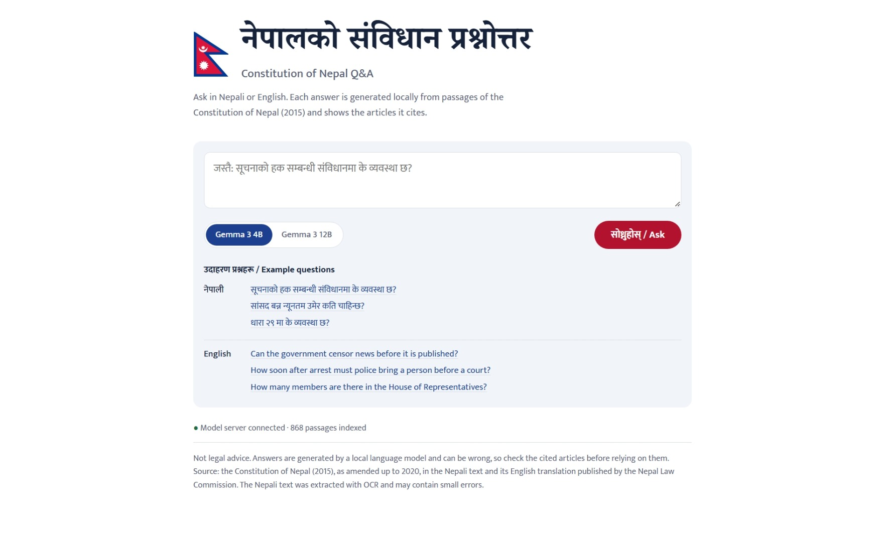
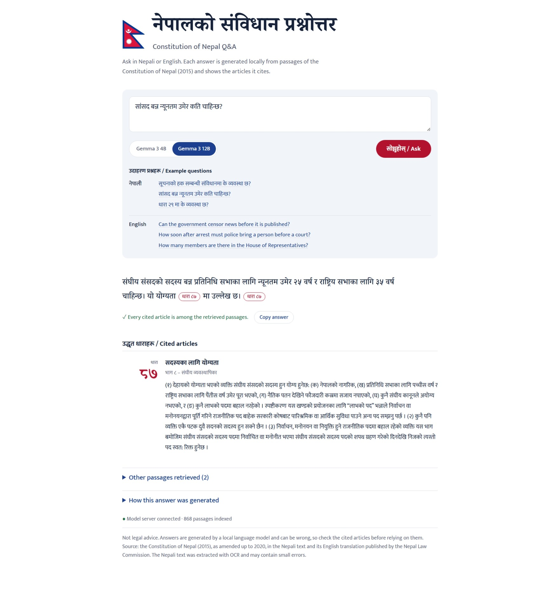
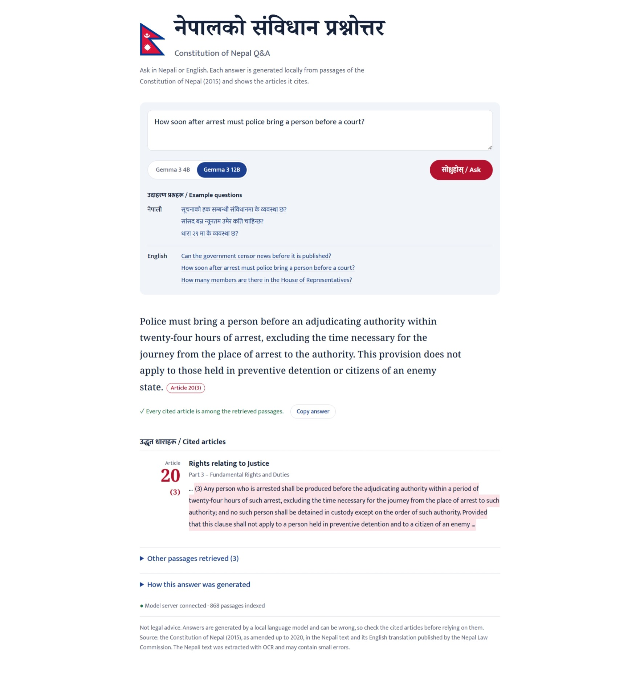

# nepal-law-rag

Bilingual (Nepali / English) question answering over the **Constitution of Nepal (2015)**, built with retrieval-augmented generation (RAG). Everything runs locally on a laptop (RTX 2060, 6 GB), with no API costs.



**Nepali question** (Gemma 3 12B): *सांसद बन्न न्यूनतम उमेर कति चाहिन्छ?*



**English question** (Gemma 3 12B): *How soon after arrest must police bring a person before a court?*



Ask in either language. The system retrieves passages from both the official Nepali text and its English translation, generates an answer with a local LLM, and shows the articles the answer cites (down to the clause, when the answer names one) next to the source text. A citation to an article that was not among the retrieved passages is flagged.

## Highlights

- **Built a Nepali corpus from a broken source.** The official Nepali PDF has a corrupted text layer. OCR plus sequence-aware parsing recovered all 308 articles (305 automatically, 3 documented manual fixes).
- **308 aligned Nepali–English article pairs**, split into 868 clause-aware chunks.
- **Retrieval:** correct article ranked first for all 54 answerable evaluation questions (dense retrieval + article-number routing). BM25 and hybrid retrieval did *worse* than dense retrieval alone; see below.
- **Answer quality, manually scored:** gemma3:4b 0.83, gemma3:12b 0.91. The 12B's gain was entirely in English; Nepali stayed at 0.87.
- **Found and fixed a prompt bug** in which the model copied the example citation from the prompt: the revised prompt raised citation recall from 83% to 94% (96% after a further revision).

## How it works

```
Question (ne/en)
  -> article-number routing ("धारा ५१", "Article 51")  -- direct lookup
  -> dense retrieval: BAAI/bge-m3 (multilingual) + ChromaDB, top 5 chunks, max 2 per article
  -> local LLM via Ollama (gemma3:4b default, gemma3:12b optional), temperature 0
  -> answer + citations, each checked against the retrieved passages
```

| Component | Choice | Why |
|---|---|---|
| Embeddings | `BAAI/bge-m3` | Multilingual, supports Nepali; cross-lingual retrieval works out of the box |
| Vector store | ChromaDB (local) | No server, persistent |
| LLM | gemma3:4b / 12b via Ollama | 4B fits a 6 GB GPU (12B runs partly on the CPU); more fluent Nepali than qwen2.5:7b in an initial comparison |
| Web app | FastAPI + one HTML page | Streams progress (retrieval, then generation); separates cited articles from other retrieved passages; highlights the cited clause |

## Data pipeline

**Source:** the Nepali text and its English translation, both published by the [Nepal Law Commission](https://lawcommission.gov.np) (as amended up to 2020).

1. **The Nepali PDF's text layer is corrupted.** The font's glyph-to-Unicode mapping is broken, and several different letters extract as the same character (e.g. `कानून हो` -> `कानून िो`, `जनतामा` -> `जनिामा`). Because the mapping is many-to-one, the text cannot be repaired with find-and-replace.
2. **OCR** with Tesseract (`nep`, `tessdata_best`), at 300 dpi with the header and footer cropped. Of the three page-segmentation modes tested (`--psm 3`, `4`, `6`), only `--psm 6` kept the article numbers.
3. **Sequence-aware article parsing.** Articles must run 1..308 without gaps. The parser detects headings loosely and assigns numbers with one-heading lookahead, which corrects misread digits (e.g. `१२५` read as `१२४`) and missed headings. Result: 305/308 automatic, 4 digit errors corrected, 3 manual fixes recorded in `data/fixes.json`. The PDF text layer, whose article sequence could be traced up to Article 134, was used as an independent check: 0 page mismatches for Articles 3–134.
4. **Cleanup:**
   - A spurious `ु` added by OCR (`गर्नेछु` -> `गर्नेछ`, 4 cases).
   - 2 part-title typos (`data/part_title_fixes.json`).
   - Page numbers that had leaked into article text at page breaks: 93 English and 28 Nepali occurrences found by a pattern check, some OCR-garbled such as `0८ -`. 2 Nepali fragments merged into text lines remain.
   - Next-part headings attached to the last article of each part in the English text (34 cases).
5. **English parsing** from the PDF text layer. Two quirks of the source document were handled: front matter that looks like numbered articles, and a missing colon after the Article 242 heading in the English translation.
6. **Chunking:** chunk bodies of at most 1,200 characters, split at clause boundaries `(१)`, then sub-items `(क)`, then sentences. Each chunk gets a header such as `भाग ३ – मौलिक हक र कर्तव्य | धारा ४२: सामाजिक न्यायको हक`, so that questions naming an article match its chunks. 404 Nepali + 464 English = **868 chunks**.
7. **Alignment check:** part numbers come from the English side (55 Nepali articles carried a misread part number, but every Nepali part heading was detected; 2 titles needed the typo fix above); the Nepali/English length ratio per article (median 0.75) showed no sign of mis-split articles.

## Evaluation

**Evaluation set:** 60 questions, as 30 Nepali–English pairs: fact, paraphrase (worded in everyday terms rather than the article's own), article-number lookup, and 6 negative questions (not answerable from the Constitution). Questions were drafted with LLM assistance; gold articles were checked against the article text during manual answer scoring, and the Nepali phrasing was verified by a native speaker.

### Retrieval (54 answerable questions, article level)

| Method | Hit@1 | Hit@5 | MRR |
|---|---|---|---|
| **Dense (bge-m3)** | 0.98 | 1.00 | 0.988 |
| BM25 | 0.56 | 0.76 | 0.660 |
| Hybrid (reciprocal rank fusion) | 0.83 | 0.96 | 0.889 |
| **Dense + article-number routing** | **1.00** | **1.00** | **1.000** |

Likely reasons, from inspecting the misses:
- **Number collisions in headers** (observed). For `धारा २९`, BM25 returned Part 29 articles, since `२९` appears in their `भाग २९` headers.
- **Nepali morphology** (probable). Suffixes attach to words (`-को`, `-मा`, `-ले`, `-हरू`), so without stemming a question's `नियुक्त गर्छ` cannot match a form such as `नियुक्ति`.
- **Equal-weight fusion with a much weaker retriever** (probable) adds noise rather than signal.

Dense retrieval's only miss was a Nepali article-number lookup, which routing fixes deterministically. Two gold labels were corrected during development (Articles 214/221 also define local-government powers). This set is now too easy to show further retrieval gains.

### Answer quality

Manual correctness scores (1 / 0.5 / 0) from a single annotator; prompt frozen at v3. These scores were measured before the page-number and part-heading cleanup above; retrieval was re-evaluated after it, and the final setup (dense + routing) was unchanged.

| | gemma3:4b | gemma3:12b |
|---|---|---|
| **Overall** | 0.833 | **0.908** |
| English | 0.800 | **0.950** |
| Nepali | **0.867** | **0.867** |
| Paraphrase questions | 0.783 | **0.950** |
| Citation recall / precision | 96% / 80% | 98% / 90% |
| Negative questions refused | 6/6 | 6/6 |
| Mean generation time | **2.1 s** | 21.9 s |

- **Retrieval is not the bottleneck.** The correct article was retrieved for every answerable question, yet 16 of 54 gemma3:4b answers were imperfect. In the annotator's notes, the most common error is *adding a detail the text doesn't say* (e.g. the President chairing the Council of Ministers).
- **Scale helped English but not Nepali.** The 12B fixed comprehension errors in Nepali but introduced errors copying numbers (minimum age for President 35 instead of 45; 175 FPTP seats instead of 165). The 12B scored higher on 14 questions and lower on 6 (sign test p ≈ 0.12, so a trend, not a significant result).

### Prompt iterations (gemma3:4b)

| | v1 | v2 | v3 |
|---|---|---|---|
| Citation recall | 83% | 94% | 96% |
| Citation precision | 70% | 82% | 80% |
| Devanagari in English answers | 43% | 30% | 27% |

v1's prompt said `cite like (धारा ७)`. The model copied `धारा ७` into eight answers whose correct article was a different one. Describing the format without an example number fixed it. v3 added a fixed refusal sentence, which introduced one new failure: the model refused "is the death penalty allowed?" while citing the article that forbids it, confusing *prohibited* with *not mentioned*.

### Other measurements

- **Tokenizer cost** (measured on sample prompts): Nepali uses 2.96 characters per token against 4.46 for English with gemma3, but Nepali text is about 25% shorter, so the same legal content costs only about 1.1× more tokens in Nepali.
- **Power mode:** gemma3:4b ran at 12.4 tokens/s in Windows "Balanced" mode and 62.8 tokens/s in "Best performance" (plugged in). All reported timings use Best performance.
- **English conventions in Nepali answers:** on the 30 Nepali questions, gemma3:12b used `.` instead of `।` in 3 answers and `Article` instead of `धारा` in 5; gemma3:4b did neither. The web app normalizes this for display.

## Known limitations

- **Schedules are not indexed.** Questions such as "how many provinces?" (answered in Schedule 4) fail.
- **Evaluation:** 60 questions, a single annotator, and the prompt was developed on the same questions. There is no held-out set yet.
- The 12B makes number errors in Nepali.
- Occasionally the models write characters from other Indian scripts inside Nepali words (e.g. Gujarati `ત` in the model's `चिंतित`), which breaks rendering: 1 of 60 Nepali evaluation answers (12B, Bengali), plus a 4B case observed in the app after the data cleanup. The web app maps these back to Devanagari for display, which works because Unicode lays out these scripts in parallel blocks.
- gemma3:4b sometimes cites a clause number as an article number (e.g. "Article 3" for Article 9(3)).
- Some OCR typos remain (e.g. `नियतक्ति` for `नियुक्ति` in the Nepali title of Article 129).
- The first answer after switching models is slower, because Ollama has to load the other model.
- **Not legal advice.**

## Running it

Tested on Windows 11, RTX 2060 (6 GB), 16 GB RAM, Python 3.10.

```powershell
python -m venv .venv; .\.venv\Scripts\Activate.ps1
pip install torch --index-url https://download.pytorch.org/whl/cu128
pip install -r requirements.txt
ollama pull gemma3:4b; ollama pull gemma3:12b
```

Also install Tesseract and put `nep.traineddata` from `tessdata_best` in `tessdata/`. Download both PDFs from the Nepal Law Commission into `data/raw/` as `constitution_ne.pdf` and `constitution_en.pdf`. The OCR script expects the project at `C:\projects\nepal-law-rag` and Tesseract at its default install path; if yours differ, edit the two paths at the top of `scripts/ocr_full.py`.

```powershell
# data pipeline (in order)
python scripts\ocr_full.py
python scripts\parse_ne.py
python scripts\apply_fixes.py
python scripts\fix_part_titles.py
python scripts\normalize_ne.py
python scripts\parse_en.py
python scripts\build_chunks.py
python scripts\build_index.py

# evaluation
python scripts\eval_retrieval.py
# eval_answers.py writes eval/manual_<model>_new.csv if a scored sheet already exists
python scripts\eval_answers.py gemma3:4b
python scripts\score_manual.py

# web app -> http://127.0.0.1:8000
python scripts\server.py
```

## Repository layout

```
scripts/              pipeline, retrieval (rag.py), evaluation, web server
scripts/diagnostics/  one-off checks used while building the pipeline
web/                  single-page UI
eval/                 questions, results, manual scoring sheets
data/                 manual fixes (raw PDFs and processed files are not committed)
docs/                 screenshots
```
